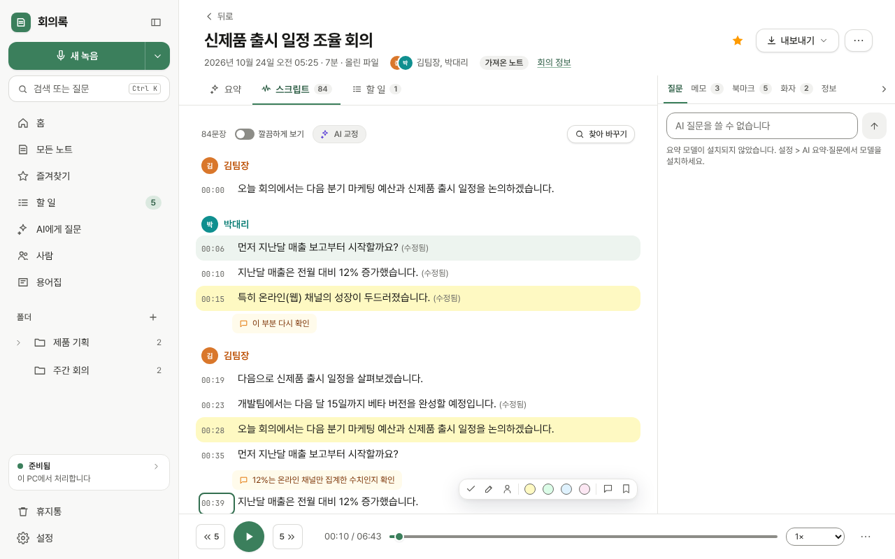

# 접근성 검토: 회의록 2.1.1

**기준:** WCAG 2.1 AA (대상 크기는 2.2의 2.5.8 참고) | **날짜:** 2026-10-24 | **대상:** [violetflag/meetinglog](https://github.com/violetflag/meetinglog) `3743aa5`
**범위:** 앱 화면 전체(홈, 목록, 노트 보기 + 오른쪽 칸, 녹음 준비·녹음 중, 할 일, AI 대화, 사람, 용어집, 검색 창, 설정 8탭, 작업 창, 대화상자, 알림, 어두운 테마, 접힌 메뉴)
**방법:** axe-core 4.10.3 자동 검사 28회(화면·상태별), 실제 Tab·화살표·Enter·Esc·Shift+F10 키 입력으로 포커스 위치와 `:focus-visible` 표시를 측정, 토큰 색 대비 계산(밝음 36쌍, 어두움 10쌍), 640×400(1280×800의 200% 확대) 배치 확인, 코드 검토(`app/src`). 실제 화면 낭독기(NVDA) 청취는 하지 않았고 낭독 내용은 접근성 트리로 추정했습니다.
**코드 수정 없음.** 검토만 했습니다.

## 요약

**문제:** 19건 | **치명:** 3 | **주요:** 9 | **경미:** 7

1.0.0 보고서의 16건은 모두 고쳐졌습니다. 노트 카드와 문장이 키보드로 열리고, 확인·입력 창이 앱 안의 창(포커스 가둠, Esc, 복귀)으로 바뀌었고, 초록 주 버튼은 4.8:1, 회색 보조 글씨는 5.3:1 이상입니다. 버튼·탭·select·슬라이더·문장 시간에 2px 초록 포커스 링이 실제 Tab 입력에서 모두 보였습니다.

새로 찾은 가장 큰 문제는 **노트 목록 행의 포커스 링이 보이지 않는 것**입니다. 행에 `outline-offset-[-2px]`를 두었지만 전역 `:focus-visible { outline-offset: 2px }`(레이어 밖)가 이기고, 목록 카드의 `overflow-hidden`이 바깥쪽 링을 잘라 냅니다. 키보드 사용자는 어느 노트가 골라졌는지 볼 수 없습니다. 다음은 **스크립트의 Tab 정지점 수**(문장마다 화자 select, 시간, 도구 9개 = 10~11개. 84문장이면 약 900번)와 **설정의 이름 없는 select 6개**, **어두운 테마 주 버튼의 대비 4.2:1**입니다.

## 발견 사항

### 인지 가능 (Perceivable)

| # | 문제 | WCAG | 심각도 | 권장 |
|---|------|------|--------|------|
| P1 | 어두운 테마: 주 버튼(새 녹음, 녹음 시작, 재생, 질문 보내기) 흰 글씨 / accent-500 `#3f8a63` 대비 **4.18:1**. axe가 홈 3곳, 설정 1곳에서 보고 | 1.4.3 대비 | 🟡 주요 | 어두운 테마의 `--color-accent-500`을 `#37805a`(4.8:1) 또는 `#2f7a56`(5.2:1)으로. 바탕과의 대비는 3:1 이상 유지됨 |
| P2 | 어두운 테마: 형광펜(노랑) 문장의 시간 글자 gray-400 `#9d9d97` / `#4a4115` **3.74:1**, "(수정됨)"도 같음 | 1.4.3 대비 | 🟡 주요 | 형광펜 바탕에서는 gray-500(`#b2b2ac`, 4.8:1)으로, 또는 어두운 yellow-100을 더 어둡게 |
| P3 | **비텍스트 대비:** 입력칸 테두리 gray-300/80 **1.5:1**, 스위치 꺼짐 트랙 gray-300 **1.5:1**, 재생 위치 줄 gray-200 **1.3:1**, 체크박스 테두리(브라우저 기본). 입력칸은 흰 카드 위 흰 칸이라 테두리가 유일한 경계입니다. 어두운 테마도 1.4~1.9:1 | 1.4.11 비텍스트 대비 | 🟡 주요 | 입력칸·스위치 트랙·슬라이더 트랙은 **3:1 이상**(밝음: `#9d9d98` 이상은 2.7:1이라 `#8f8f8a` 정도 필요, 어두움: `#6a6a65` 3.1:1). 카드 테두리는 장식이라 예외 |
| P4 | 비활성 버튼이 `opacity: 0.5`라 비활성 주 버튼의 흰 글씨가 **2.0:1**, 비활성 일반 버튼 글씨 **3.0:1**(글자가 거의 안 보임: 용어집 "추가", 할 일 "추가", 노트 보기 "번역하기") | 1.4.3 (비활성은 예외지만 읽을 수 없음) | 🟢 경미 | 비활성은 투명도 대신 바탕 gray-100 + 글자 gray-500(4.5:1 이상)으로 |
| P5 | 메모 시간 글자 `amber-800/70`(≈`#b98b5a`) / amber-50 **2.9:1**(11px, 노트 메모 칸·녹음 중 메모) | 1.4.3 | 🟢 경미 | amber-800 100% (6.8:1) |
| P6 | 640×400(200% 확대)에서 가로 스크롤은 없지만 노트 보기의 본문이 한 줄만 보임(제목·메타·탭·도구 줄이 세로 300px) | 1.4.10 리플로우 / 1.4.4 | 🟢 경미 | 디자인 보고서 U6 |

### 조작 가능 (Operable)

| # | 문제 | WCAG | 심각도 | 권장 |
|---|------|------|--------|------|
| O1 | **노트 목록 행에 포커스 링이 보이지 않습니다.** Tab 7번으로 첫 행에 포커스가 가고 `outline: 2px solid`가 계산되지만 `outline-offset`이 **+2px**(전역 `:focus-visible`이 `outline-offset-[-2px]` 유틸리티를 이김)이고 `ul.card.overflow-hidden`이 바깥 2px를 잘라 냅니다(`NoteList.tsx:565, 574`, `index.css :focus-visible`). 홈 "최근 노트"(`HomeView.tsx:316` `card overflow-hidden`)도 좌우가 잘립니다.  | 2.4.7 포커스 표시 | 🔴 치명 | `index.css`의 전역 규칙을 `@layer base`에 넣어 유틸리티가 이기게 하거나, 행에 `focus-visible:[outline-offset:-2px]`를 `!important`로. 또는 카드의 `overflow-hidden`을 `rounded-2xl` + 자식 `first:rounded-t-2xl`로 대체 |
| O2 | **스크립트 Tab 정지점 과다.** 문장마다 화자 select(첫 문장), 시간 버튼, 그리고 포커스가 들어오면 나타나는 도구 9개(선택·고치기·화자·형광펜 4·메모·북마크)가 모두 Tab 대상이라 **문장당 10~11회**. 84문장 노트는 약 900회, 1시간 회의는 수천 회입니다. 오른쪽 칸·재생 막대까지 Tab으로 가기 어렵습니다 | 2.4.3 포커스 순서 (2.1.1 보완) | 🟡 주요 | 도구 띠를 `tabIndex=-1`로 두고 시간 버튼에서 **→ 키**로 도구에 들어가게(roving tabindex), 문장 간 이동은 ↑↓. 이미 Shift+F10 메뉴가 모든 기능을 담고 있으므로 도구 띠는 마우스 전용으로 두어도 됨 |
| O3 | Ctrl+K 창을 Esc로 닫으면 포커스가 **body**로 갑니다(열기 전 위치로 돌아가지 않음, `CommandPalette.tsx` `close()`). 키보드 사용자는 처음부터 다시 Tab | 2.4.3 포커스 순서 | 🟡 주요 | 열 때 `document.activeElement`를 기억하고 닫을 때 복귀(`Modal`과 같은 방식) |
| O4 | **작은 대상:** 문장 시간 버튼 44×17, 문장 도구 23×23, 형광펜 20×20, 화자 select 37×20, 폴더 펼치기 16×20, 메모 삭제·북마크 삭제 글자 버튼 약 24×16, 화자 칸 ⋯·✓ 28×28. 노트 화면에서 24px 미만 대상 40개 이상 | 2.5.8 대상 크기(최소) / 2.5.5 | 🟡 주요 | 아이콘 버튼 최소 24×24(권장 32), 시간 버튼은 세로 패딩으로 24px, 형광펜은 버튼 하나로 |
| O5 | 탭(`role="tab"`)에서 ←/→ 키가 동작하지 않고 Tab으로 하나씩 지나야 합니다(노트 탭 3개 + 오른쪽 칸 탭 5개, 녹음 중 탭 4개). `aria-controls`도 없음 | 2.1.1 / 4.1.2 (ARIA 탭 패턴) | 🟢 경미 | tablist에서 ←/→·Home/End로 이동하고 비활성 탭은 `tabIndex=-1` |
| O6 | 녹음 중 화면 상단 줄 전체가 `role="status"`(`RecordView.tsx:633`)인데 그 안의 시계(`role="timer" aria-label`)가 **매초 바뀝니다**. 낭독기가 라이브 영역 변화를 매초 읽을 수 있습니다(실측 필요) | 4.1.3 상태 메시지 / 2.2.2 | 🟡 주요 | `role="status"`를 상단 줄에서 떼고, "녹음 중 12분"처럼 **1분마다** 갱신되는 sr-only 상태 줄을 따로 두기 |
| O7 | 되돌리기 알림이 6초, 일반 알림이 4초 뒤 사라지고 멈출 수 없습니다. 키보드로 알림의 "되돌리기"까지 가기 전에 사라집니다 | 2.2.1 시간 조절 | 🟢 경미 | 마우스 올림·포커스 중에는 멈추고, 되돌리기가 있는 알림은 10초 또는 다음 동작까지 |

### 이해 가능 (Understandable)

| # | 문제 | WCAG | 심각도 | 권장 |
|---|------|------|--------|------|
| U1 | **설정의 select 6개에 이름이 없습니다**(axe select-name). `Row`의 라벨 글자가 `<label>`로 연결되지 않음: 일반 > 기본 녹음 소리, 원본 음질, 조각 저장 주기, 말소리가 없으면 녹음 끝내기 제안; 스크립트 > 실행 방식, 기본 언어(`SettingsView.tsx:298, 305, 311, 320, 346, 355`). 낭독기는 "콤보 상자, 대면 회의 (마이크)"만 읽음 | 3.3.2 레이블 / 4.1.2 | 🔴 치명 | `Row`가 `useId()`로 라벨 id를 만들어 자식에 `aria-labelledby`를 주거나, 각 select에 `aria-label` |
| U2 | 녹음 중 도구 줄의 "AI" 칩은 자막·교정 모델 정보가 `title`에만 있어 키보드·터치 사용자는 볼 수 없음(낭독기는 `aria-label`로 들림) | 1.3.1 / 3.3.2 | 🟢 경미 | 디자인 보고서 U13 |
| U3 | 글자 깨짐 `&amp;`, `&gt;` 6곳(디자인 보고서 U4). 낭독기는 "앰퍼샌드 에이엠피 세미콜론"으로 읽음 | 3.1.1 (읽기 가능) | 🟢 경미 | 평문으로 |

### 견고성 (Robust)

| # | 문제 | WCAG | 심각도 | 권장 |
|---|------|------|--------|------|
| R1 | `role="separator"` 크기 조절 손잡이 3개에 `aria-valuenow` 없음(axe aria-required-attr, critical): 노트 오른쪽 칸 너비(`Workspace.tsx:281`), 분할 비율(`Workspace.tsx:247`), 녹음 중 오른쪽 탭 너비(`RecordView.tsx:825`). 포커스 가능한 separator는 값이 필수 | 4.1.2 이름·역할·값 | 🟡 주요 | `aria-valuemin=0 aria-valuemax=100 aria-valuenow={퍼센트}` + `aria-valuetext="340px"` |
| R2 | 오른쪽 칸 `role="tablist"` 안에 탭이 아닌 버튼("오른쪽 칸 접기")이 있음(`Workspace.tsx:293-298`, axe aria-required-children) | 4.1.2 | 🟡 주요 | 접기 버튼을 tablist 요소 밖(형제)으로 |
| R3 | 폴더가 없을 때 `role="tree"` 안에 treeitem 없이 안내문 `
`만 있음(`App.tsx:447`, axe) | 4.1.2 | 🟢 경미 | 폴더가 있을 때만 `role="tree"` |
| R4 | **제목 구조:** 노트 보기에 h1이 없음(제목이 `<input>`), 설정은 h1 → h3(`Block`이 h3, h2 없음), 작업 창·단축키 창도 h3/h2 단독(axe page-has-heading-one, heading-order) | 1.3.1 정보와 구조 | 🟢 경미 | 노트: 제목 input을 `<h1>`로 감싸거나 sr-only h1; 설정 `Block`을 h2로 |
| R5 | 랜드마크 이름 중복: 사이드바 `<aside id="sidebar">`에 이름이 없고, 용어집의 안내 `<aside>`도 이름이 없어 둘이 구분되지 않음(axe landmark-unique) | 1.3.1 / 4.1.2 | 🟢 경미 | `aria-label="사이드바"`, `aria-label="용어집 안내"` |
| R6 | 문장 묶음 `
`는 role이 없어 `aria-selected`가 허용되지 않음(`ScriptPanel.tsx:305`; 선택했을 때만 속성이 붙어 axe가 이번 검사에선 못 봄). 달력의 할 일은 "✓"/"☐" 글자로 완료를 표시(`Calendar.tsx:429`)해 낭독기가 "흰색 굵은 체크 표시"로 읽음 | 4.1.2 | 🟢 경미 | 선택은 `aria-pressed`가 있는 선택 버튼에만 두고 div의 속성 제거; 달력은 `aria-label="완료: …"` + 아이콘 `aria-hidden` |

## 색 대비

밝은 테마의 글자 대비는 36쌍 모두 통과했습니다(토큰 계산 + axe 실측 0건). 실패는 비텍스트와 비활성, 어두운 테마에 있습니다.

| 요소 | 글자/도형 | 배경 | 대비 | 기준 | 통과 |
|------|-----------|------|------|------|------|
| 주 버튼 "새 녹음" (밝음) | #ffffff | #3b7f5c | 4.80:1 | 4.5:1 | ✅ |
| 보조 글씨 gray-500 | #5b5b57 | #ffffff | 6.82:1 | 4.5:1 | ✅ |
| 시간 글자 gray-400 (11px) | #6b6b67 | #ffffff | 5.35:1 | 4.5:1 | ✅ |
| gray-400 / 노랑 형광펜 (밝음) | #6b6b67 | #fef9c2 | 4.98:1 | 4.5:1 | ✅ |
| 칩: accent-700 / accent-50 | #2b5c43 | #edf4ef | 6.92:1 | 4.5:1 | ✅ |
| 칩: ai-700 / ai-50 | #4b32b5 | #efeafd | 7.37:1 | 4.5:1 | ✅ |
| 칩: amber-800 / amber-50 | #973c00 | #fffbeb | 6.84:1 | 4.5:1 | ✅ |
| 칩: red-700 / red-50 | #c10007 | #fef2f2 | 5.87:1 | 4.5:1 | ✅ |
| 화자 이름 sky-700 / emerald-700 / amber-700 | – | #ffffff | 5.86 / 5.36 / 5.03 | 4.5:1 | ✅ |
| 포커스 링 accent-600 | #336f50 | #ffffff | 5.95:1 | 3:1 | ✅ |
| **주 버튼 (어두움)** | #ffffff | #3f8a63 | **4.18:1** | 4.5:1 | ❌ P1 |
| **gray-400 / 노랑 형광펜 (어두움)** | #9d9d97 | #4a4115 | **3.74:1** | 4.5:1 | ❌ P2 |
| **입력칸 테두리 gray-300** | #d2d2ce | #ffffff | **1.52:1** | 3:1 | ❌ P3 |
| **스위치 꺼짐 트랙 gray-300** | #d2d2ce | #ffffff | **1.52:1** | 3:1 | ❌ P3 |
| **재생 위치 줄 gray-200** | #e5e5e2 | #ffffff | **1.26:1** | 3:1 | ❌ P3 |
| 비활성 주 버튼 (50%) | #ffffff | ≈#9dbfad | 2.00:1 | (예외) | P4 |
| 비활성 일반 버튼 글씨 (50%) | ≈#969695 | #ffffff | 2.96:1 | (예외) | P4 |
| 메모 시간 amber-800/70 | ≈#b98b5a | #fffbeb | 2.93:1 | 4.5:1 | ❌ P5 |

axe 자동 검사 색 대비 위반: 밝은 테마 0건, 어두운 테마 8건(모두 P1·P2).

## 키보드

실제 키 입력으로 측정했습니다. ✅ = 동작하고 포커스 링이 보임.

| 요소 | Tab 이동 | Enter/Space | Escape | 화살표 | 비고 |
|------|----------|-------------|--------|--------|------|
| 사이드바 메뉴·새 녹음·검색 | ✅ (14 정지점) | ✅ | – | – | 접힌 메뉴도 모든 버튼에 이름 있음 |
| 폴더 트리 | ✅ treeitem | ✅ | – | (코드상 지원) | 펼치기 버튼 16×20 (O4) |
| 노트 목록 행 | ✅ 가지만 **링 안 보임** | ✅ Enter 열기 확인 | ✅ 선택 해제 | ✅ ↑↓ | **O1** |
| 목록 행 Shift+F10 | – | ✅ 메뉴 열림, 첫 항목 포커스 | ✅ 행으로 복귀 확인 | ✅ | WAI-ARIA 메뉴 패턴 |
| 노트 탭 / 오른쪽 칸 탭 | ✅ 하나씩 | ✅ | – | ❌ ←→ 안 됨 | O5 |
| 스크립트 문장 (시간 버튼) | ✅ | ✅ Enter 재생, E/F2 고치기 확인 | ✅ 편집 취소 | – | 문장당 10~11 정지점 **O2** |
| 문장 도구 9개 | ✅ 모두 Tab 대상 | ✅ | – | – | O2, O4 |
| 재생 위치 슬라이더 | ✅ | – | – | ✅ ←→ Home End | 이름·값 있음 |
| 재생 옵션 팝오버 | ✅ 첫 컨트롤로 | ✅ | ✅ 버튼으로 복귀 | – | |
| Ctrl+K 창 | ✅ 입력칸 | ✅ Enter 실행 | ✅ 닫히지만 **포커스 body** | ✅ ↑↓ | **O3** |
| 확인·입력·화자 확인 창 | ✅ 첫 입력으로 | ✅ | ✅ 복귀 | – | `Modal`이 포커스 가둠 |
| 설정 탭·select·스위치 | ✅ | ✅ Space | – | ✅ select | 스위치 링 보임(sr-only + peer) |
| 녹음 중 화면 | ✅ | ✅ | – | ✅ 너비 조절 ←→ | 상단 role=status (O6) |

## 화면 낭독기 (접근성 트리 기준 추정)

| 요소 | 낭독 (추정) | 문제 |
|------|-------------|------|
| 설정 > 기본 녹음 소리 select | "콤보 상자, 대면 회의 (마이크)" | 어떤 설정인지 모름 (U1) |
| 노트 보기 제목 | "노트 제목, 편집 가능, 신제품 출시…" | h1이 없어 제목 탐색(H 키)으로 못 감 (R4) |
| 오른쪽 칸 너비 손잡이 | "오른쪽 칸 너비 조절, 구분선" | 값 없음, 조절 중 피드백 없음 (R1) |
| 오른쪽 칸 "접기" 버튼 | 탭 목록 안의 버튼 | 탭 개수가 6개로 들림 (R2) |
| 녹음 중 상단 줄 | 매초 시계 변화가 상태 영역 안에서 발생 | 반복 낭독 가능성 (O6) |
| 문장 시간 버튼 | "00:06부터 재생, 버튼, 단축키 E F2 Shift+F10" | 좋음 |
| 접힌 메뉴 할 일 | "할 일, 남은 6개" | 좋음 |
| 작업 상태 줄 | "작업 상태: 준비됨 · 이 PC에서 처리합니다. 누르면 작업 창을 엽니다" | 좋음 |
| 알림 | role=status/alert + aria-live | 좋음, 다만 사라지는 시간 (O7) |
| 달력의 할 일 | "흰색 굵은 체크 표시 다음 분기…" | 글자 아이콘 (R6) |
| 글자 깨짐 | "할 일 기한 앰퍼샌드 에이엠피 세미콜론 구글 일정" | U3 |

## 고칠 순서

1. **목록 행 포커스 링 (O1).** 전역 `:focus-visible` 규칙을 `@layer base`로 옮기면 유틸리티가 이기므로 한 줄 수정으로 해결됩니다. 키보드 사용자가 목록을 쓸 수 있게 됩니다.
2. **설정 select 이름 (U1).** `Row`에 `useId()` 라벨 연결을 추가하면 6개가 한 번에 고쳐집니다.
3. **스크립트 Tab 정지점 (O2)과 Ctrl+K 포커스 복귀 (O3).** 긴 회의록을 키보드로 읽는 사람에게 가장 큰 차이입니다.
4. **어두운 테마 대비 (P1, P2)와 비텍스트 대비 (P3).** 토큰 값 3~4개 교체입니다.
5. **ARIA 수정 (R1, R2, R3, R6)과 대상 크기 (O4).** 기계적인 수정입니다.
6. **녹음 중 상태 영역 (O6)과 알림 시간 (O7).** NVDA로 직접 들어 보고 결정하세요.

예상 버전: 1~5번은 화면이 그대로라 **2.1.2**, 6번과 대상 크기(O4)로 배치가 바뀌면 **2.2.0**. 디자인 보고서의 수정과 묶어 2.2.0 한 번으로 내는 것을 권합니다.

자동 검사는 문제의 약 30%만 잡습니다. 고친 뒤에는 NVDA로 노트 목록 → 노트 열기 → 문장 고치기 → 녹음 시작·끝내기까지 한 번 직접 들어 보는 확인이 필요합니다.

## 수정 결과 (2.2.0)

[meetinglog PR #1](https://github.com/violetflag/meetinglog/pull/1) (브랜치 `fix/ui-review-2.1.1`, 버전 2.2.0)에 19건을 모두 반영했습니다. 같은 Playwright 스크립트로 다시 측정했습니다.

| 측정 | 2.1.1 | 2.2.0 |
|------|-------|-------|
| axe-core 4.10.3 위반 (전 화면 합계) | 46개 노드 / 7개 규칙 (26화면) | **0** (27화면) |
| 스크립트 Tab 정지점 (문장당) | 10~11 | **1** (화자 바뀌면 +1, 도구는 → 키) |
| 목록 행 포커스 링 | 바깥쪽 잘림 | 안쪽 2px 링 표시 (`outline-offset: -2px`) |
| Ctrl+K 창 Esc 뒤 포커스 | body | 열기 전 요소(노트 제목 입력칸)로 복귀 |
| 어두운 테마 주 버튼 대비 | 4.18:1 | **4.78:1** (`#37805a`) |
| 어두운 테마 형광펜 시간 글자 | 3.74:1 | **4.82:1** (yellow-100 `#38300f`) |
| 입력칸 테두리·스위치 꺼짐 트랙 | 1.5:1 | **3.38:1** (`--color-line #8c8c87`) |
| 비활성 버튼 글자 | 2.0~3.0:1 | gray-100 바탕 + gray-500 글자 (4.5:1 이상) |
| 문장 도구 버튼 | 23×23, 형광펜 20×20 | 24×24 |

| # | 결과 | 어떻게 |
|---|------|--------|
| P1, P2, P3, P4, P5 | ✅ | 토큰 교체(`--color-line` 추가, 어두운 brand/accent-500, 어두운 yellow-100), `.btn:disabled` 회색 배경·글자색, 메모 시간 amber-800 100% |
| P6 | ✅ | 디자인 U6 |
| O1 | ✅ | 전역 `:focus-visible`을 `@layer base`로 이동. 홈 최근 노트도 `outline-offset-[-2px]` |
| O2 | ✅ | 도구 띠 `role="toolbar"`, 도구 `tabIndex=-1`, 시간 버튼에서 →/←로 진입·이동, Esc로 복귀 |
| O3 | ✅ | 열기 전 `activeElement`를 첫 렌더에서 기억해 닫을 때 복귀 (effect 안에서 잡으면 입력칸이 이미 포커스를 가져가 실패) |
| O4 | ✅ | 문장 도구·시간·폴더 펼침·메모/북마크 삭제 버튼 24px 이상. 메타 줄의 인라인 글자 링크와 할 일 줄 인라인 버튼은 2.5.8 인라인 예외로 그대로 |
| O5 | ✅ | 노트 탭·오른쪽 칸 탭·녹음 중 탭 모두 roving tabindex + ←/→, `aria-controls`/`aria-labelledby` |
| O6 | ✅ | 상단 줄 `role=status` 제거, 분 단위로만 바뀌는 sr-only 상태 줄 |
| O7 | ✅ | 알림 마우스 올림·포커스 중 멈춤, 되돌리기 8초 |
| U1 | ✅ | `Row`가 `useId()`로 라벨 id를 만들어 이름 없는 select/input에 `aria-labelledby` |
| U2, U3 | ✅ | 디자인 U13, U4 |
| R1 | ✅ | separator 3개에 `aria-valuemin/max/now/text` |
| R2 | ✅ | 접기 버튼을 tablist 밖으로 |
| R3 | ✅ | 폴더가 있을 때만 `role="tree"` |
| R4 | ✅ | 노트 sr-only h1, 녹음 중 화면 sr-only h1, 엔진 오류 화면 h1, 설정 `Block`·작업 창 h2, 요약 칸 소제목 h2 |
| R5 | ✅ | 사이드바 `aria-label="사이드바"`, 용어집 안내 `aria-labelledby` |
| R6 | ✅ | div의 `aria-selected` 제거, 달력 ✓/☐ `aria-hidden` + sr-only "완료:"/"할 일:" |

남은 일: 자동 검사는 문제의 약 30%만 잡으므로, NVDA로 노트 목록 → 노트 열기 → 문장 고치기(→ 키로 도구 진입) → 녹음 시작·끝내기까지 직접 들어 보는 확인은 아직 하지 않았습니다.
