# 디자인 검토: 회의록 2.1.1

**날짜:** 2026-10-24 | **대상:** [violetflag/meetinglog](https://github.com/violetflag/meetinglog) `3743aa5` (앱 2.1.1, 2.0 "조용한 노트" 디자인)
**범위:** 홈, 노트 목록(전체·폴더·즐겨찾기·휴지통), 노트 보기(요약·스크립트·할 일 + 오른쪽 칸 5개), 녹음 준비·녹음 중, 할 일, AI 대화, 사람, 용어집, 검색(Ctrl+K), 설정 8개 탭, 작업 창, 단축키·확인·입력 창, 처음 실행 화면, 어두운 테마, 접힌 메뉴
**방법:** 실제 Python 엔진(모델 없이)과 Vite 개발 화면을 띄우고 Tauri 호스트(녹음기·장치·파일 창)만 흉내 내어, `docs/manual/exports/long_ko.mlnote`를 6번 가져온 시험 데이터로 1280×800에서 78장을 캡처했습니다(어두운 테마 4장, 640×400 = 200% 확대 5장, 1024px 1장 포함). 녹음 중 화면은 녹음기 상태와 `/live` 응답을 가짜로 넣어 그렸습니다. 코드로 동작을 다시 확인했습니다.
**코드 수정 없음.** 대비·키보드·레이블·낭독기는 [접근성 보고서](accessibility-review.md)에 있으므로 여기서는 번호만 적습니다. 1.0.0 보고서의 항목은 모두 고쳐진 것을 확인했습니다(가로 잘림, 상단 버튼 줄, 기본 창, 엔진 패널, 설정 목차).

## 첫인상

2.0 재설계로 화면이 크게 좋아졌습니다. 따뜻한 회색 한 벌과 채도를 낮춘 초록 하나, AI 작업만 보라색으로 구분하는 규칙이 모든 화면에서 지켜지고, 카드·칩·버튼 모양이 하나입니다. 홈은 "지금 할 일"(바로 녹음, 진행 중, 최근 노트, 남은 할 일)에 집중되어 처음 써도 무엇을 누를지 압니다.

가장 큰 개선 기회는 **노트 보기의 첫 화면**입니다. 노트를 열면 "요약" 탭이 먼저 열리는데, 로컬 AI 모델이 없으면 이미 들어 있는 요약(가져온 노트, 외부 API로 만든 요약)까지 숨기고 "AI 요약을 쓸 수 없습니다" 카드만 보여 줍니다. 다음은 **같은 사람의 색이 화면마다 다른 것**(녹음 중·목록은 이름 해시, 스크립트·화자 칸은 화자 순서)과, **설정과 할 일 화면의 글자 깨짐**(`&amp;`, `&gt;`가 그대로 보임)입니다.

## 사용성

| # | 발견 | 심각도 | 권장 |
|---|------|--------|------|
| U1 | 노트 보기의 요약 탭이 로컬 LLM이 없으면 **저장된 요약도 숨깁니다**. 시험 노트에는 전체 요약·주제별 요약·할 일이 들어 있는데 "AI 요약을 쓸 수 없습니다" 카드만 보입니다 (`app/src/views/note/SummaryPanel.tsx:103`의 이른 return). 외부 API로 요약한 뒤 로컬 모델을 끈 사용자도 같은 일을 겪습니다. 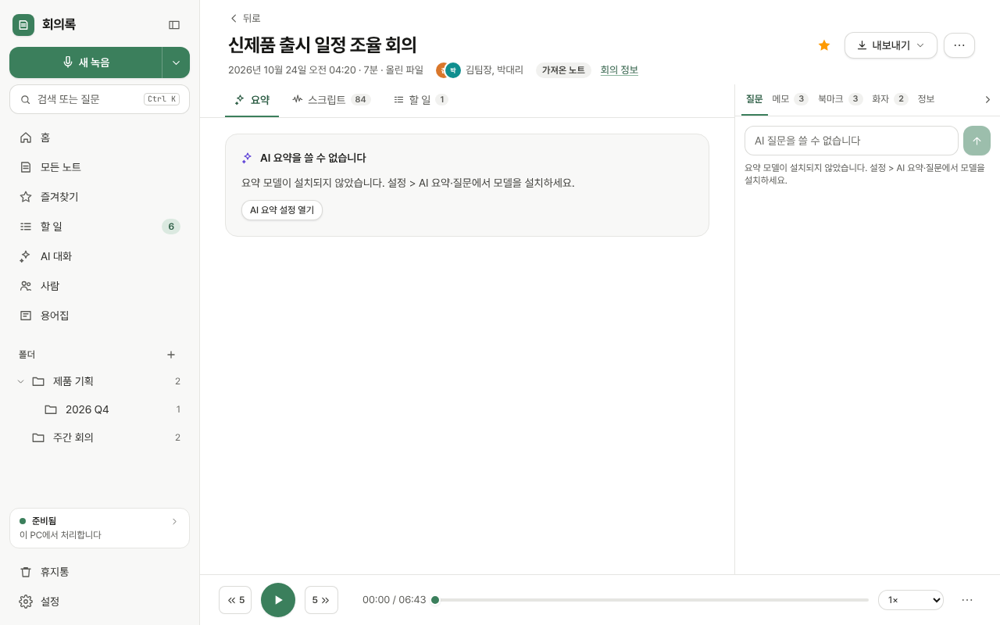 | 🔴 치명 | 저장된 요약은 항상 보여 주고, "쓸 수 없음" 안내는 '다시 만들기' 버튼 자리에만 작게. 요약이 하나도 없는 노트는 **스크립트 탭을 먼저** 열기 |
| U2 | **처음 실행 준비 화면이 모든 메뉴를 막습니다.** 사이드바의 홈·모든 노트·설정을 눌러도 선택 표시만 바뀌고 화면은 그대로입니다(`App.tsx:489`, `setup`이 있으면 모든 view를 덮음). "건너뛰기"를 눌러야 풀립니다. 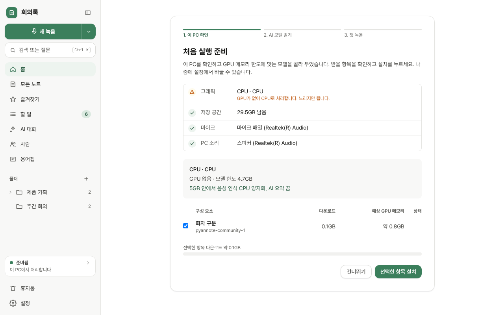 | 🔴 치명 | 준비 화면은 홈에서만 보여 주거나, 다른 메뉴를 누르면 닫히는 카드로. 또는 준비 중에는 사이드바를 비활성화해 '안 되는 것'을 분명히 |
| U3 | **같은 사람의 색이 화면마다 다릅니다.** 김팀장이 목록·홈·녹음 중 화면에서는 주황, 스크립트·화자 칸·화자 확인 창에서는 파랑입니다. `Avatar`가 `index`(노트 안 화자 순서)를 받으면 순서 색, 없으면 이름 해시 색을 쓰기 때문입니다(`ScriptPanel.tsx:283`, `SpeakersPanel.tsx:116` ↔ `NoteList.tsx:617`, `RecordView.tsx:788`). 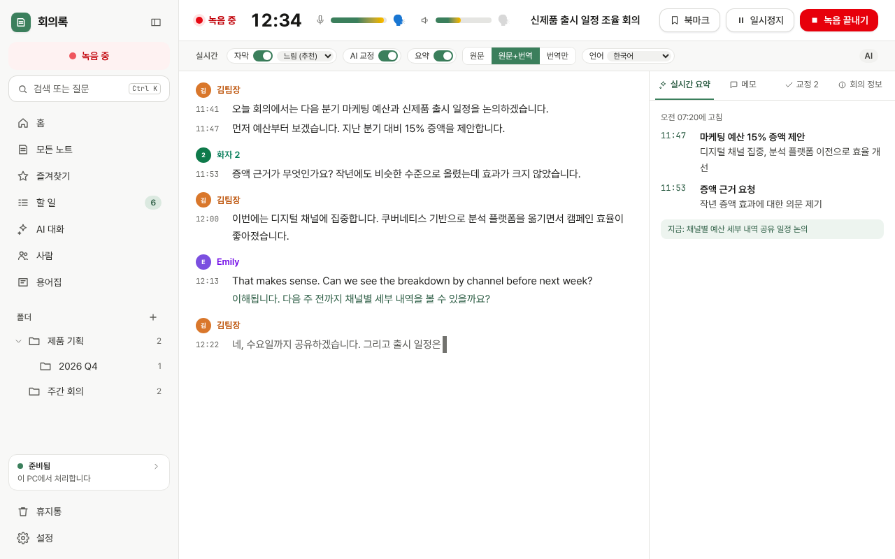 | 🟡 중간 | 규칙 하나로: **이름이 붙은 사람은 이름 해시 색**, 이름 없는 "화자 N"만 순서 색. 스크립트의 화자 이름 글자색(`SPEAKER_TEXT`)도 같은 인덱스를 쓰도록 |
| U4 | **HTML 엔티티가 글자로 보입니다.** 할 일 화면 달력 제목 "할 일 기한 &amp; 구글 일정"(`TodoView.tsx:353`), 설정 > 연결의 "API 및 서비스 &gt; 라이브러리", "고급 &gt; 이동"(`GoogleSettings.tsx:83, 92`), "설정 &gt; 개발자 &gt; 설정 편집"(`McpSettings.tsx:39`), 성능 탭 "설정 &gt; AI 제공자"(`ResidentSettings.tsx:75`), 영어 번역 5곳(`locales/en.ts`). JSX 문자열은 자동으로 이스케이프되므로 `&`, `>`를 그대로 쓰면 됩니다. 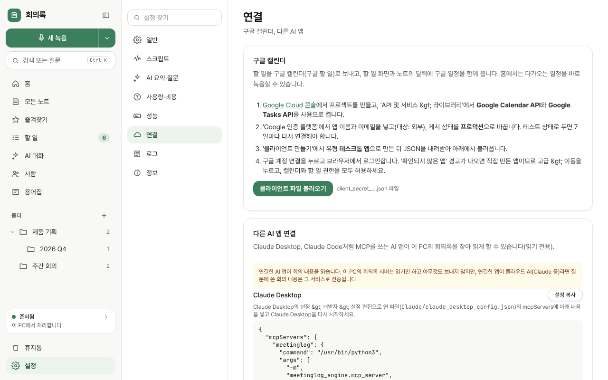 | 🟡 중간 | 6곳(+영어 5곳) 치환. 시험으로 `grep -rn "&amp;\|&gt;" app/src` 가 0건이어야 함 |
| U5 | 노트 보기에서 알림(토스트)이 **재생 막대 위를 덮습니다.** 북마크·메모 삭제 뒤 "되돌리기" 알림이 재생 위치 줄과 시간 표시를 4~6초 가립니다. 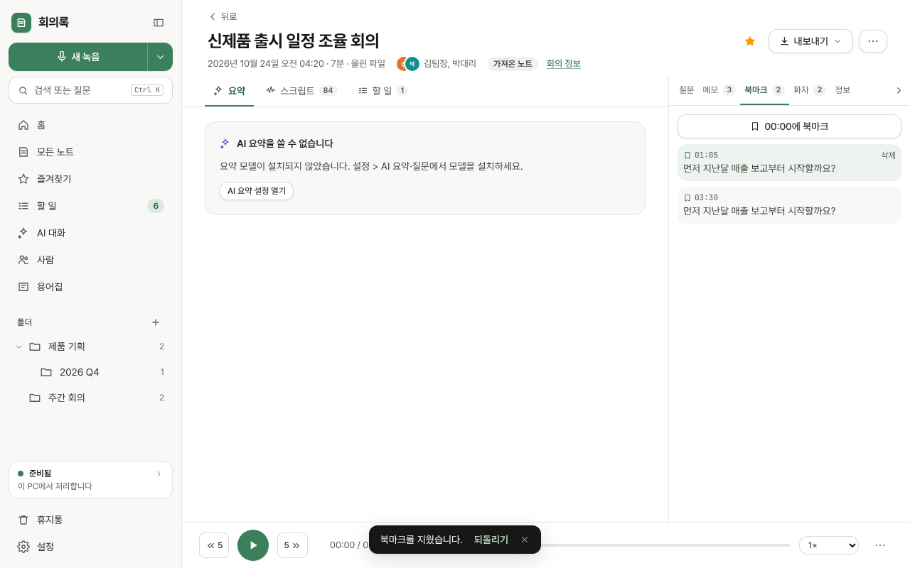 | 🟡 중간 | 재생 막대가 있는 화면에서는 알림을 막대 위(bottom-20)로 올리거나 오른쪽 위에 표시 |
| U6 | **창이 좁거나 200% 확대하면 노트 화면이 거의 쓸 수 없습니다.** 640×400에서 제목·메타 줄·탭·스크립트 도구 줄이 세로의 75%를 차지해 문장이 한 줄만 보이고, 재생 막대의 ⋯ 버튼이 둘째 줄로 떨어집니다. 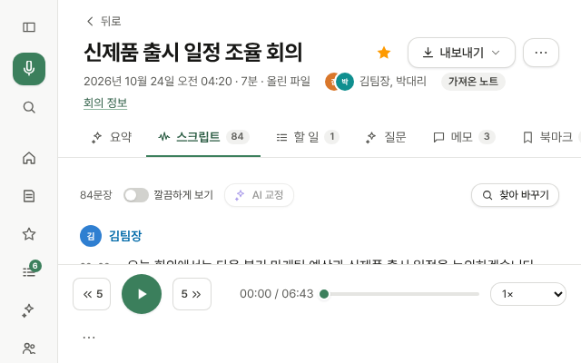 | 🟡 중간 | 좁을 때: 메타 줄 숨기기, 제목 한 줄, 스크립트 도구 줄은 '⋯'로 접기, 재생 막대는 한 줄 고정(속도·옵션을 ⋯ 안으로) |
| U7 | **켜고 끄는 컨트롤이 두 모양입니다.** 대부분 스위치인데 성능 > 구성 요소별 상시 켜기(`ResidentSettings.tsx:104`), 사용량·비용 > 사용량 보기(`UsageSettings.tsx:94`), 로그 > 자동 새로 고침(`LogViewer.tsx:139`)은 기본 체크박스입니다. 상시 켜기 체크박스는 오른쪽 끝에 작게 떠 있어 어느 줄의 것인지 알기 어렵습니다. 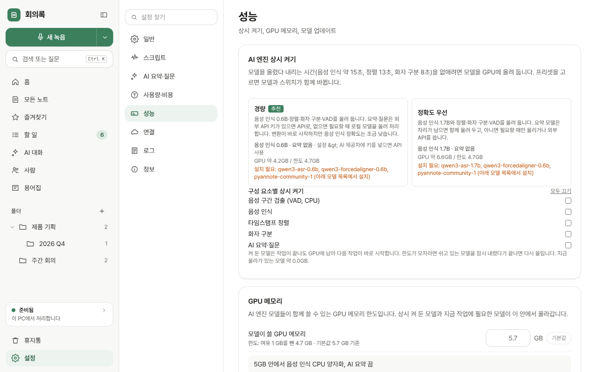 | 🟡 중간 | 설정의 `Switch` 컴포넌트를 세 곳에도 쓰기 |
| U8 | 할 일 줄에 "날짜 10/8(목) · 기한 10/8(목) · 지남"처럼 같은 날짜가 두 번 나옵니다(시작일 = 기한일 때). 오른쪽 달력 아이콘 버튼은 무엇인지(구글로 보내기) 글자가 없습니다. 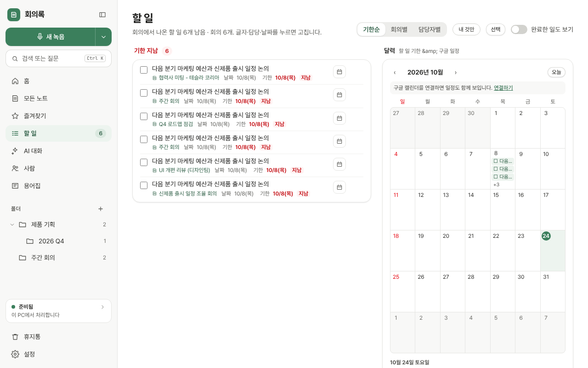 | 🟡 중간 | 시작일이 기한과 같거나 기본값이면 기한만. 구글 버튼은 연결 전에는 숨기거나 "구글" 글자를 붙이기 |
| U9 | 노트 정보 칸의 "음성 인식 qwen3-asr-1.7b@7278e1e7"에 해시가 그대로 보입니다. `modelName()`이 있는데 여기서는 쓰지 않습니다. 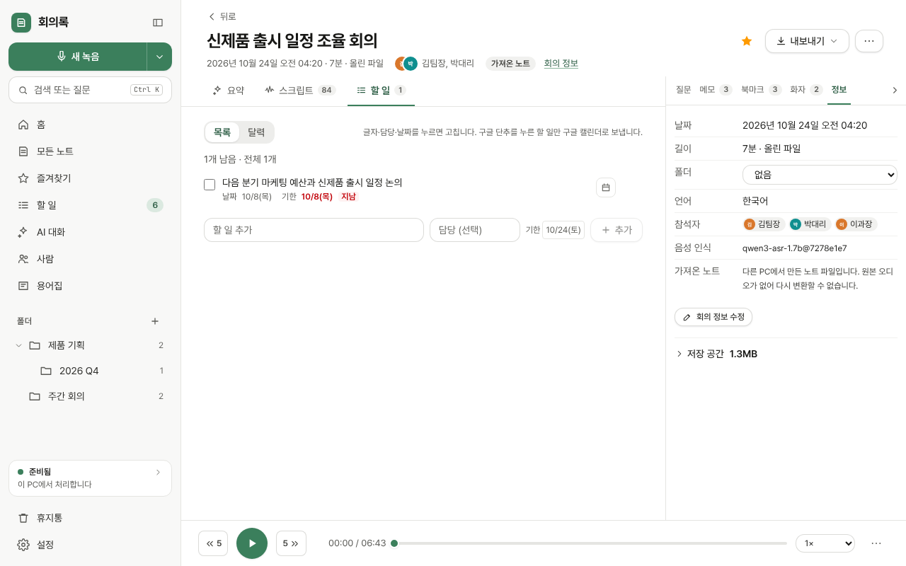 | 🟢 낮음 | `modelName(note.asr_model)` |
| U10 | 문장에 마우스를 올리면 나오는 도구 띠가 **윗줄 문장의 끝을 가립니다**(`-top-4`). 아이콘 9개(선택·고치기·화자·되돌리기·형광펜 4색·메모·북마크)가 한 줄이라 형광펜 4개가 눈에 띄는 비중을 차지합니다. 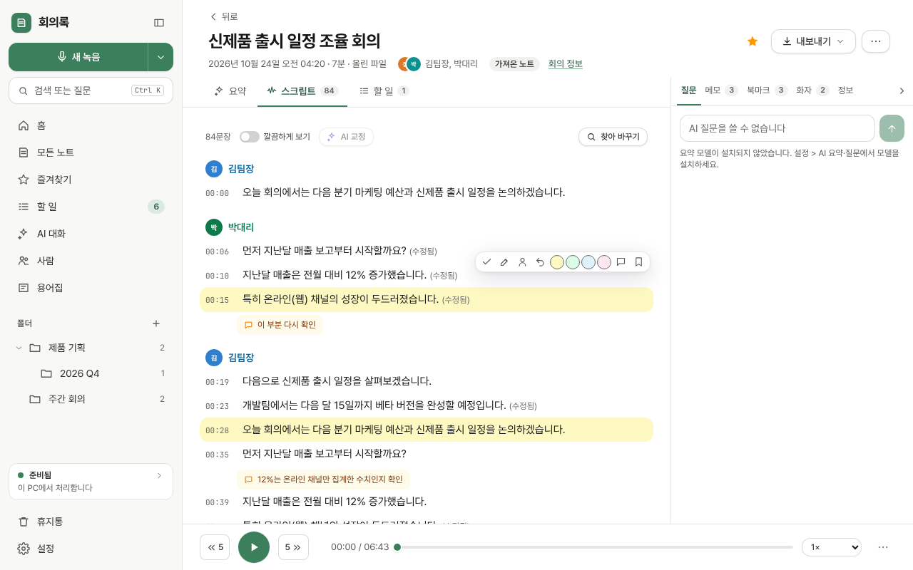 | 🟢 낮음 | 띠를 문장 오른쪽 안쪽에 두고, 형광펜은 버튼 하나(누르면 4색) |
| U11 | 녹음 준비 화면의 제목 칸에 "회의"가 미리 채워져 있어 안내문 "비우면 내용에서 자동으로 붙입니다"와 어긋납니다(`RecordView.tsx:115`). 비우려면 지워야 하고, 대부분은 그대로 두어 "회의"가 줄줄이 생깁니다. | 🟢 낮음 | 값은 비우고 placeholder로 "회의 (비우면 내용에서 자동)" |
| U12 | 사람 카드의 둘째 줄이 1280px에서 "회의 6개 · 발언 32분 · 최근 20…"으로 잘려 가장 쓸모 있는 '최근' 날짜가 안 보입니다. 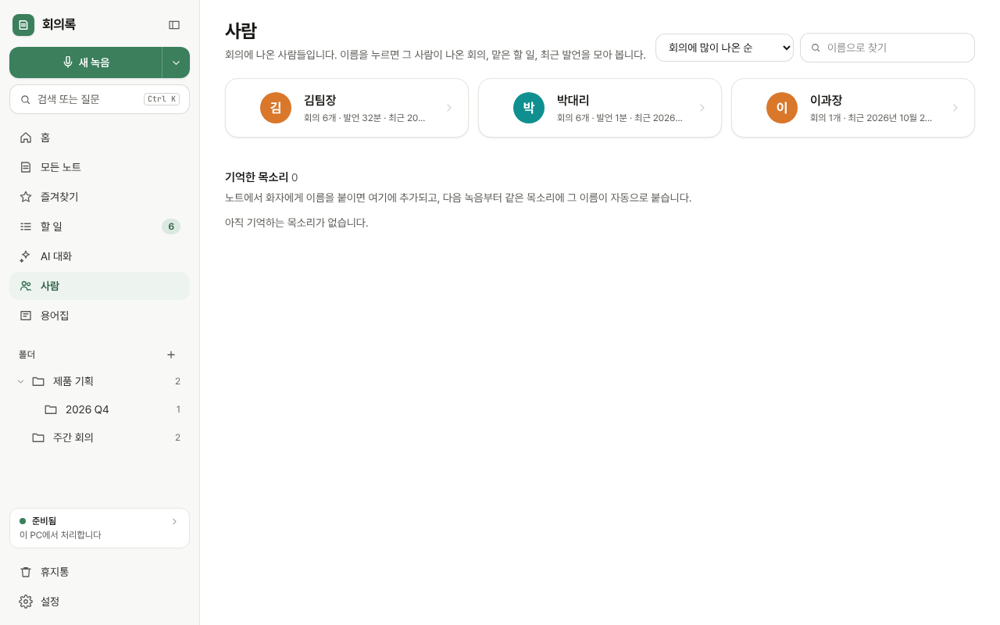 | 🟢 낮음 | 날짜를 "10월 24일"처럼 짧게, 또는 둘째 줄 줄바꿈 허용 |
| U13 | 녹음 중 도구 줄 오른쪽 끝의 "AI" 칩은 무슨 뜻인지 마우스를 올려야 알 수 있습니다(자막 모델, 교정 모델). 녹음 끝내기 승인 중에는 "녹음 끝내기" 버튼이 두 개(위 빨강 비활성, 안내 상자 초록) 보입니다. 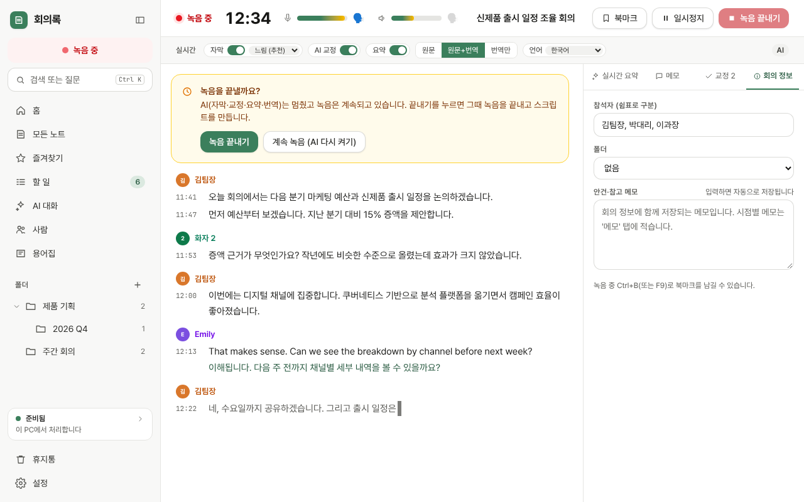 | 🟢 낮음 | "AI · 자막 0.6B · 교정 Opus"처럼 짧게 풀어 쓰고, 승인 중에는 위 버튼을 숨기기 |
| U14 | 메뉴 이름 "AI 대화" ↔ 화면 제목 "AI에게 질문" ↔ 노트 탭 "질문" ↔ 설정 탭 "AI 요약·질문". 같은 기능이 네 이름입니다. | 🟢 낮음 | 메뉴와 화면 제목을 하나로("AI에게 질문" 권장) |

노트 목록에서 키보드로 행을 고를 때 테두리가 보이지 않는 문제(목록 카드가 바깥쪽 포커스 링을 잘라 냄)는 사용성 면에서도 가장 큰 문제입니다. 접근성 보고서 O1을 참고하세요.

## 시각적 위계

- **먼저 눈에 띄는 것:** 모든 화면에서 사이드바의 초록 "새 녹음"과 화면 제목(24px bold)입니다. 앱의 핵심 동작이라 맞습니다. 홈에서는 "녹음 시작" 큰 버튼이 두 번째로 보이고, 세 가지 녹음 종류 카드가 그 위에 있어 '고르고 시작'하는 순서가 자연스럽습니다. 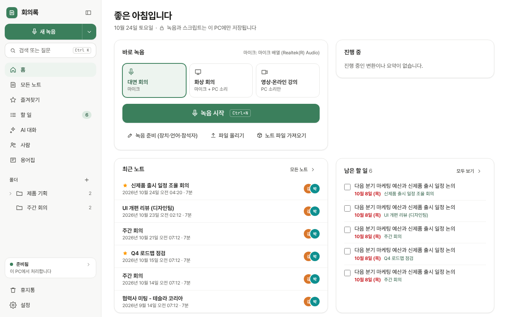
- **노트 보기:** 제목 → 메타 한 줄(날짜·길이·출처·화자) → 탭 → 내용. 1.0.0보다 훨씬 정돈됐습니다. 다만 요약 탭이 비어 있으면(U1) 첫 화면이 "쓸 수 없습니다" 카드와 빈 공간이라, 회의 내용이 한 글자도 안 보입니다. 스크립트 탭은 화자 이름·시간·문장의 세 열이 잘 정렬되고 줄 간격(1.75)이 넉넉해 읽기 좋습니다. 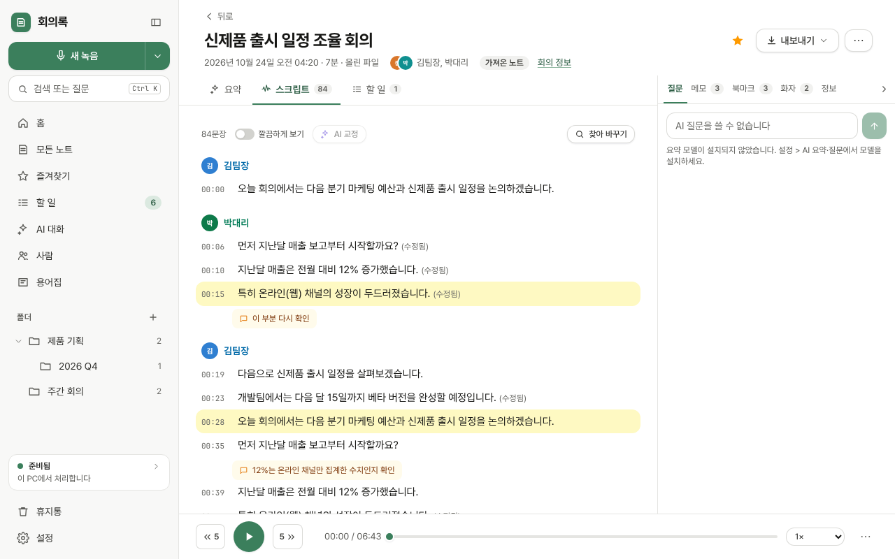
- **녹음 중:** 빨간 점·시간·레벨·제목·버튼이 한 줄, 실시간 도구가 한 줄, 그 아래 자막과 오른쪽 탭. 위계가 분명하고 "녹음 끝내기"만 빨간 채움이라 위험한 동작이 구분됩니다.
- **목록:** 오늘/어제/이번 주/지난주/월별 묶음이 훑어보기를 돕고, 상태 칩(변환 중 42% 주황, AI 요약 중 보라, 실패 빨강)이 제목 옆에 붙어 무엇이 진행 중인지 바로 보입니다. 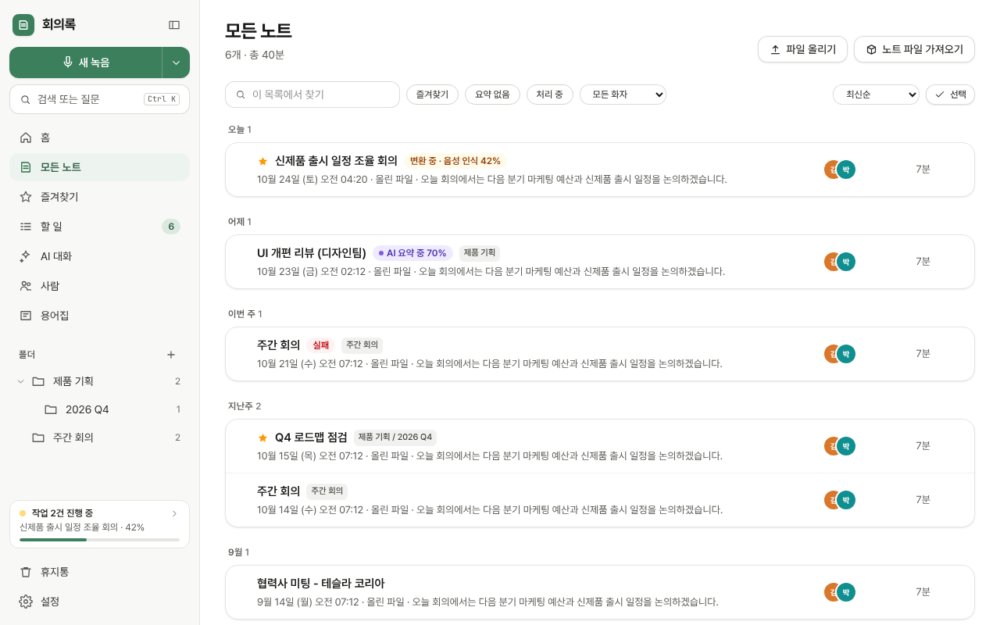
- **설정:** 8개 탭과 "설정 찾기"로 1.0.0의 4,000px 한 페이지가 해결됐습니다. 각 탭의 첫 카드가 가장 자주 쓰는 항목(언어·테마, 음성 인식 모델, AI 제공자)이라 순서도 맞습니다. 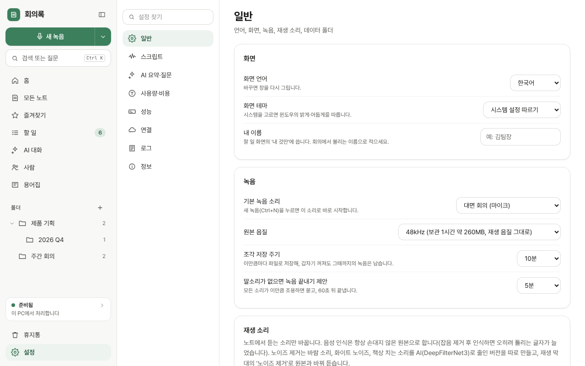
- **어두운 테마:** 같은 토큰 이름을 다시 정의하는 방식이라 모든 화면이 깨짐 없이 따라옵니다. 초록 주 버튼의 흰 글씨 대비가 4.2:1로 조금 모자랍니다(접근성 P1). 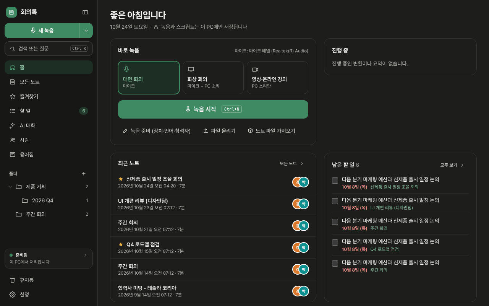

## 일관성

| 요소 | 문제 | 권장 |
|------|------|------|
| 사람 색 | 목록·홈·녹음 중: 이름 해시 / 스크립트·화자 칸·화자 확인 창: 화자 순서 (U3) | 이름이 있으면 해시, 없으면 순서 |
| 켜기/끄기 | 스위치 vs 기본 체크박스 세 곳 (U7) | `Switch` 하나 |
| 이름 | AI 대화 / AI에게 질문 / 질문 / AI 요약·질문 (U14); 노트 탭 "정보" ↔ 링크·메뉴 "회의 정보" | 각각 하나로 |
| 글자 | `&amp;`, `&gt;` 노출 6곳 (U4) | 평문으로 |
| 포커스 링 | 전역 `:focus-visible`(바깥 2px)과 목록 행의 `outline-offset-[-2px]`가 충돌해 행에서만 링이 사라짐 (접근성 O1) | 행에 `focus-visible:outline-offset-[-2px]`를 레이어 밖에서 적용하거나 카드의 `overflow-hidden` 제거 |
| 작은 글씨 | 10px(교정 태그, Ctrl K 키 표시, 로그 수준 칩), 9px(접힌 메뉴 배지), 11px 40곳 | 보조 글씨 하한을 11px, 누르는 글씨는 12px 이상 |
| 알림 위치 | 모든 화면에서 아래 가운데. 노트 보기에서는 재생 막대와 겹침 (U5) | 화면에 따라 올리기 |
| 날짜 형식 | 목록 "10월 24일 (토) 오전 04:20", 홈 "2026년 10월 24일 오전 04:20", 할 일 "10/8(목)", 달력 "2026년 10월" | 한 화면 안에서는 한 형식; 올해면 연도 생략 규칙을 공통 함수로 |

## 접근성 (요약)

자세한 내용은 [접근성 보고서](accessibility-review.md)를 보세요. 핵심은 **노트 목록 행의 보이지 않는 포커스 링**, **문장마다 10~11개씩 늘어나는 Tab 정지점**(84문장이면 약 900번), **설정의 이름 없는 select 6개**, **어두운 테마 주 버튼 대비 4.2:1**, **입력칸·스위치·재생 줄의 테두리 대비(1.3~1.5:1)** 입니다. 밝은 테마의 글자 대비는 모두 4.5:1을 넘고, 버튼·탭·슬라이더의 포커스 링은 잘 보입니다.

## 잘 된 점

- 홈 화면이 "지금 할 일"로만 구성되어 있고, 녹음 종류 카드 → 큰 녹음 시작 버튼 → 보조 동작(준비·올리기·가져오기)의 순서가 명확합니다.
- 상태 칩 색 규칙(진행 주황, AI 보라, 실패 빨강, 완료는 표시 없음)이 목록·홈·작업 창에서 같습니다.
- Ctrl+K 창 하나로 노트·문장·명령·설정을 찾고, 결과에 찾은 글자가 형광으로 표시됩니다. 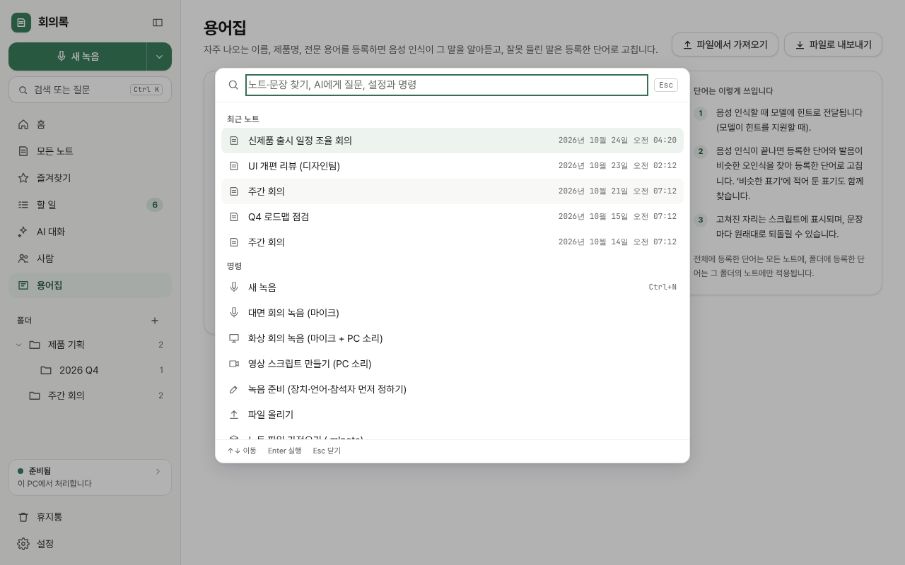
- 작업 창이 작업·엔진·GPU 메모리를 한 곳에 모아 1.0.0의 엔진 패널보다 조용하고, 필요할 때만 열립니다. 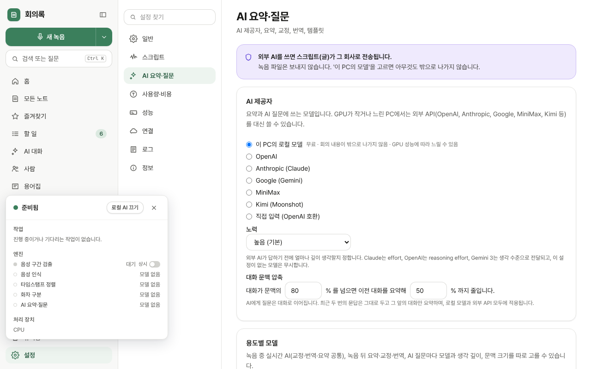
- 되돌리기 알림(휴지통·완료·북마크 삭제)으로 확인 창 없이 빠르게 작업하고도 실수를 되돌릴 수 있습니다.
- 빈 상태마다 다음 행동 버튼(새 녹음·파일 올리기)이 있고, 엔진 시작 중·오류 화면이 분명합니다.
- 설정의 "저장됨" 표시와 설정 찾기, 외부 AI 사용 시 데이터가 나간다는 보라색 안내가 신뢰를 줍니다.
- 화자 확인 창은 각 화자의 대표 문장 두 개를 보여 주어 누구인지 판단하기 쉽습니다. 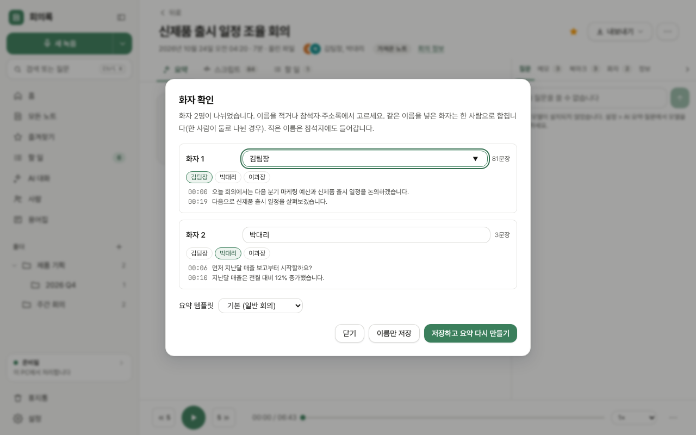

## 우선 고칠 것

1. **요약 탭이 저장된 요약을 숨기는 것 (U1) + 요약 없으면 스크립트 탭 먼저.** 노트를 열 때마다 겪는 첫 화면이라 체감이 가장 큽니다. 코드 몇 줄입니다.
2. **글자 깨짐 (U4)과 포커스 링 (접근성 O1).** 둘 다 한 줄짜리 수정이고, 하나는 모든 사용자가 보는 오타, 하나는 키보드 사용자가 목록을 못 쓰게 하는 문제입니다.
3. **사람 색 규칙 (U3).** 녹음 중 화면에서 본 색과 노트의 색이 다르면 "같은 사람인가?" 하는 의심이 생깁니다. `Avatar`와 `SPEAKER_TEXT` 인덱스 계산을 한 함수로 모으면 됩니다.
4. **처음 실행 준비 화면의 메뉴 막힘 (U2).** 첫 5분의 인상입니다.
5. **스위치 통일 (U7), 할 일 줄 날짜 (U8), 알림 위치 (U5).** 작은 수정들입니다.
6. **좁은 창·확대 배치 (U6)와 어두운 테마 대비 (접근성 P1).** 노트북 반 화면이나 확대해 쓰는 사용자용입니다.

예상 버전: 1~5번은 기능이 그대로라 **2.1.2**(수 버전), 6번처럼 배치가 바뀌면 **2.2.0**. 접근성 수정과 묶으면 2.2.0 한 번으로 낼 수 있습니다.

## 수정 결과 (2.2.0)

위 항목은 [meetinglog PR #1](https://github.com/violetflag/meetinglog/pull/1) (브랜치 `fix/ui-review-2.1.1`, 버전 2.2.0)에서 모두 반영되었습니다. 캡처는 `img/after/`에 있습니다.

| # | 결과 | 어떻게 |
|---|------|--------|
| U1 | ✅ | 요약 없는 노트는 스크립트 탭을 먼저 열고, 요약 모델이 있으면 "AI 요약 만들기" 띠. 모델이 없어도 저장된 요약은 보이고 만들기 버튼만 비활성 + 설정 링크 |
| U2 | ✅ | 첫 실행 모델 선택은 홈 화면만 차지. 다른 메뉴는 그대로 동작 |
| U3 | ✅ | `Avatar`에 `colorIndexOf`/`speakerTextClass`: 이름 있으면 이름 해시 색, "화자 N"은 회색. 아바타·글자색·녹음 중 화면 공통 |
| U4 | ✅ | `&gt;`/`&amp;` 6곳 평문으로, en.json 키도 교체 |
| U5 | ✅ | 알림은 재생 바가 있으면 그 위(`bottom-20`)로, 마우스 올림·포커스 중 멈춤, 되돌리기 알림 8초 |
| U6 | ✅ | 좁은 창: 메타 줄은 `sm` 이상에서만, 재생 속도는 옵션 메뉴 안으로. 640×400에서 가로 스크롤 없음 |
| U7 | ✅ | 공용 `Toggle` 컴포넌트. 상시 켜기·사용량·로그의 체크박스를 스위치로 통일 |
| U8 | ✅ | 할 일 줄의 날짜는 시작일과 기한이 다를 때만 |
| U9 | ✅ | `fmtDateShort`(요일·시각, 올해가 아니면 연도)로 홈·목록·할 일 통일 |
| U10 | ➖ | 문장 도구 띠 위치는 그대로. 대신 Tab 정지점에서 빼고 → 키로 진입하게 바꿔 키보드에서는 걸리지 않음 |
| U11 | ✅ | 녹음 제목 비우면 안내문("비우면 '회의'로 두었다가 AI 요약이 생기면 내용으로 제목을 붙입니다") |
| U12 | ✅ | 끝내는 동안 상단 "녹음 끝내기" 숨김 |
| U13 | ✅ | AI 칩에 자막·교정 모델 이름을 글자로(`AI · 자막 0.6B · 교정 qwen3-8b`) |
| U14 | ✅ | 사람 카드 부제 줄바꿈, 정보 칸 모델 이름은 짧게(전체 키는 title) |

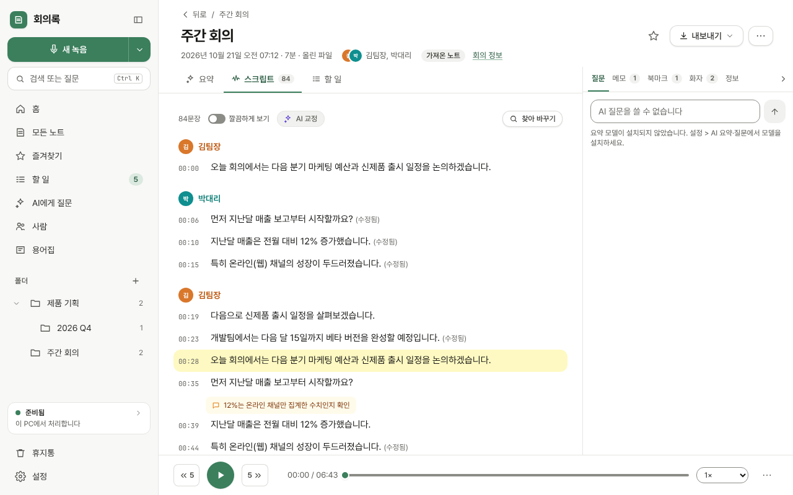

## 캡처 목록

`img/` 폴더에 이 보고서가 가리키는 24장이 있습니다. 전체 78장과 axe 결과(`results.json`), 키보드 측정(`keyboard.json`)은 세션 작업 폴더에서 만들었고, 재현 스크립트는 `app`에서 `npx vite --port 1420`과 `python -m meetinglog_engine --data-dir <폴더> --port 8765`를 띄운 뒤 Playwright로 `http://localhost:1420/`에 `window.__TAURI_INTERNALS__`를 흉내 내어 접속하는 방식입니다.
